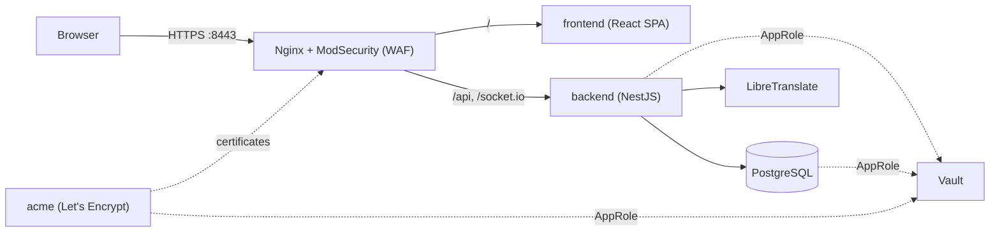
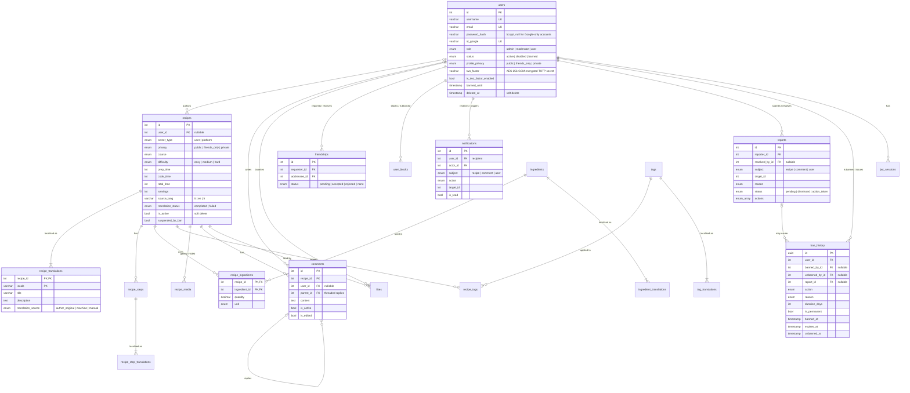

*This project has been created as part of the 42 curriculum by daromoli, gmercuri, mdalloli, lhima, sel-khao.*

<p align="center">
  
</p>

<h1 align="center">WeCook</h1>

<p align="center">
  A multilingual social cookbook with an interactive 3D kitchen.<br/>
  ft_transcendence · 42 Firenze
</p>

---

## Table of Contents

1. [Description](#description)
2. [Instructions](#instructions)
3. [Team Information](#team-information)
4. [Project Management](#project-management)
5. [Technical Stack](#technical-stack)
6. [Architecture](#architecture)
7. [Database Schema](#database-schema)
8. [Features List](#features-list)
9. [Modules](#modules)
10. [Individual Contributions](#individual-contributions)
11. [Usage](#usage)
12. [Known Limitations](#known-limitations)
13. [Resources](#resources)
14. [Credits and License](#credits-and-license)

---

## Description

**WeCook** is a social network for home cooks. Users publish their own recipes, browse the community's recipes inside a **3D kitchen where a leather-bound cookbook can be opened and its pages turned**, add friends, comment, save favorites and receive real-time notifications.

Every recipe is written once, in the author's language, and is **automatically translated into Italian, English and French** by a self-hosted machine-translation service. The whole interface is available in the same three languages.

The goal of the project, as required by the ft_transcendence subject, is to design and ship a complete, secure, containerized web application as a team: frontend, backend and database, deployed with a single command over HTTPS.

### Key features

- **Recipes**: structured ingredients from a curated catalog, ordered steps with durations, tags, course, difficulty, cover photo, gallery and tutorial video.
- **Automatic translation** of recipes (IT / EN / FR) with LibreTranslate and visible translation provenance.
- **3D cookbook** on the home page, built with Three.js (React Three Fiber).
- **Social layer**: public profiles, friends with real-time online status, threaded comments, favorites, friends feed, user blocking.
- **Real-time notifications** over WebSockets.
- **Advanced search** with filters, sorting and pagination.
- **Privacy controls** per recipe and per profile (public, friends only, private).
- **Moderation**: content reports, warnings, time-limited bans, moderator and admin panels.
- **Security**: hashed passwords, JWT in httpOnly cookies, Google OAuth 2.0, TOTP two-factor authentication, ModSecurity WAF, HashiCorp Vault for secrets, HTTPS everywhere.
- **Recipe export to PDF**, generated in the browser.
- Accessible **Privacy Policy** and **Terms of Service** pages (footer links).

---

## Instructions

### Prerequisites

| Software       | Version               | Notes                                                   |
| -------------- | --------------------- | ------------------------------------------------------- |
| Docker Engine  | 24+                   | Rootless mode is supported                              |
| Docker Compose | v2 (`docker compose`) |                                                         |
| GNU Make       | any recent            | Drives the whole lifecycle                              |
| Google Chrome  | latest stable         | Supported browser                                       |
| Node.js + npm  | 22                    | **Only** to run tools outside Docker (OpenAPI, Postman) |

Free ports on the host: **8443** (HTTPS) and **8080** (HTTP redirect). In development, 5432 (PostgreSQL) and 5555 (Prisma Studio) are also exposed.

### 1. Clone and configure the environment

```bash
git clone https://github.com/LuHima/ft_transcendence_cooking_book.git
cd ft_transcendence_cooking_book
cp docker/.env.example docker/.env
```

Edit `docker/.env`. The most important variables:

| Variable                                            | Description                                                                                                               |
| --------------------------------------------------- | ------------------------------------------------------------------------------------------------------------------------- |
| `DOMAIN_NAME`                                       | `localhost` in development, the real domain in production                                                                 |
| `PRODUCTION_FLAG`                                   | `false`: self-signed TLS certificate. `true`: Let's Encrypt certificate (DNS-01 via Infomaniak)                           |
| `USE_VAULT`                                         | `true` (default): secrets are read from HashiCorp Vault. `false`: secrets are read from `.env`                            |
| `WAF_PARANOIA`                                      | ModSecurity / OWASP CRS paranoia level (we use **3**)                                                                     |
| `POSTGRES_USER`, `POSTGRES_PASSWORD`, `POSTGRES_DB` | Database credentials                                                                                                      |
| `TWO_FACTOR_AUTH`                                   | 32-byte hex key used to encrypt TOTP secrets (`node -e "console.log(require('crypto').randomBytes(32).toString('hex'))"`) |
| `GOOGLE_CLI_ID`, `GOOGLE_CLI_SECRET_KEY`            | Google OAuth credentials (optional: without them the Google button is hidden)                                             |
| `UPLOADS_DIR`                                       | Where uploaded media are stored inside the backend container                                                              |

`docker/.env` is ignored by Git. Never commit it.

### 2. Initialize Vault (once per machine)

```bash
make vault-init
```

This initializes Vault (5 key shares, threshold 3), enables the KV v2 engine and AppRole auth, writes one least-privilege policy per service, stores the secrets and writes the AppRole IDs into `docker/.env`. Unseal keys and root token are saved **outside the repository** in `~/vault-keys/`.

Vault is sealed after every restart. `make` unseals it automatically if `VAULT_UNSEAL_KEY_1..3` are set in `docker/.env`, otherwise it prompts for the keys (`make vault-unseal` does the same on demand).

> Without Vault: set `USE_VAULT=false` and add `DATABASE_URL`, `JWT_SECRET`, `JWT_REFRESH_SECRET`, `COOKIE_SECRET` and `TWO_FACTOR_AUTH` to `docker/.env`.

### 3. Start the project (single command)

```bash
make
```

Then open **https://localhost:8443** (accept the self-signed certificate in development).

On startup the backend applies the Prisma migrations and seeds the database with the ingredient and tag catalogs, demo users and demo recipes.

### Useful commands

| Command | Description |
| --- | --- |
| `make` | Start the stack (dev or prod according to `PRODUCTION_FLAG`) |
| `make dev` | Development stack: hot reload, ports 5432 / 5555 |
| `make prod` | Production stack: hardened images, no debug ports |
| `make down` | Stop and remove containers (keeps data) |
| `make re` | Rebuild everything from scratch (deletes volumes) |
| `make logs [service]` / `make logsf [service]` | Show / follow logs |
| `make exec <service>` | Open a shell in a container |
| `make db-reset` | Reset the database and re-seed |
| `make db-studio start` | Open Prisma Studio on port 5555 |
| `make api` | Regenerate `openapi.json` and the Postman collection |
| `make postman-test` | Run the API contract tests with Newman |
| `make help` | List every target |

### Demo accounts

All seeded accounts use the password `Password123`.

| Email | Role |
| --- | --- |
| `marghe@example.com` | admin |
| `sarah@example.com` | moderator |
| `mario@example.com`, `giulia@example.com`, `marco@example.com`, … | user |
| `alex2fa@example.com` | user with 2FA enabled |

These accounts exist for evaluation and development only.

---

## Team Information

| Login | Name | Role(s) | Responsibilities |
| --- | --- | --- | --- |
| daromoli | Dario Romoli | **Technical Lead**, Developer | As Tech Lead: owns the technical architecture and stack choices, records design decisions as ADRs, keeps the API contract (OpenAPI / Postman) in sync and reviews critical changes. As Developer: most backend domains (recipes, users, friends, feed, catalog, reports, admin, media, translation), database schema, Nginx/WAF tuning, Makefile |
| lhima | Luis Hima | **Product Owner**, Developer | As PO: defines the product vision and feature priorities, validates completed features against the subject requirements. As Developer: authentication (JWT sessions, Google OAuth, 2FA), CASL authorization, WebSocket notification gateway, initial backend and Docker setup |
| mdalloli | Margherita Dallolio | **Project Manager**, Developer | As PM: organizes the work, distributes tasks, plans and tracks progress and deadlines, coordinates the team. As Developer: frontend application (all pages, components, API client, auth flow, real-time UI), internationalization, admin and moderation panels |
| gmercuri | Giovanni Mercurio | Developer | 3D kitchen scene and interactive recipe book (Three.js / React Three Fiber) |
| sel-khao | Sara El Khaouly | Developer | DevOps and security: HashiCorp Vault, ACME/Let's Encrypt container, Nginx/ModSecurity, Docker networks, ingredient catalog |

---

## Project Management

- **Work organization**: `<describe: e.g. weekly meetings, task split by domain (backend, frontend, 3D, DevOps), feature branches merged through pull requests>`.
- **Design decisions** are recorded as **Architecture Decision Records** in [`docs/adr`](docs/adr) (35 ADRs), and a shared vocabulary is kept in [`GLOSSARY.md`](GLOSSARY.md).
- **API contract**: the OpenAPI specification ([`openapi.json`](openapi.json)) is generated from the backend code and turned into a Postman collection, so frontend and backend always agree on endpoints and payloads. Public docs are built with Fern.
- **Tools**: GitHub (repository, issues, pull requests), `<GitHub Issues / Projects / Trello / Notion>`, Postman.
- **Communication**: `<Discord / WhatsApp / Slack>` and in-person sessions at 42 Firenze.

---

## Technical Stack

### Frontend

| Technology | Use |
| --- | --- |
| **React 19** + **TypeScript** | SPA framework |
| **Vite** | Dev server and build tool |
| **React Router 7** | Client-side routing, protected and modal routes |
| **Tailwind CSS 4** | Styling, with custom design tokens |
| **Three.js**, **React Three Fiber**, **drei** | 3D kitchen and animated recipe book |
| **i18next** / **react-i18next** | Interface translation (IT / EN / FR) |
| **socket.io-client** | Real-time notifications and presence |
| **jsPDF** | Client-side PDF export |

### Backend

| Technology                                | Use                                           |
| ----------------------------------------- | --------------------------------------------- |
| **NestJS 11** (Node.js 22, TypeScript)    | REST API and WebSocket gateway                |
| **Prisma 7**                              | ORM, migrations, seeding                      |
| **Passport**, **@nestjs/jwt**, **bcrypt** | Authentication, JWT, password hashing         |
| **google-auth-library**                   | Google ID token verification (OAuth 2.0)      |
| **otplib**, **qrcode**                    | TOTP two-factor authentication                |
| **CASL**                                  | Role- and ownership-based authorization       |
| **Socket.IO**                             | Real-time gateway                             |
| **@nestjs/throttler**                     | Rate limiting                                 |
| **class-validator**                       | DTO validation                                |
| **Sharp** / **FFmpeg**                    | Image (WebP) and video (H.264 MP4) processing |
| **@nestjs/swagger**                       | OpenAPI documentation (`/api/docs`)           |
| **Jest**, **Supertest**, **Newman**       | Unit, e2e and API contract tests              |

### Database

**PostgreSQL**. We chose it because the data is strongly relational (users, recipes, translations, friendships, comments, reports), because it guarantees integrity through foreign keys, unique constraints and transactions (important with many concurrent users), and because it works natively with Prisma. Features we rely on include native enums, composite primary keys, composite indexes and array columns.

### Infrastructure

| Technology | Use |
| --- | --- |
| **Docker** + **Docker Compose** | Containerization, single-command deployment |
| **Nginx** + **ModSecurity** + **OWASP CRS** | Reverse proxy, TLS termination, WAF (paranoia level 3) |
| **HashiCorp Vault** | Secret storage with one AppRole and policy per service |
| **acme.sh** (Let's Encrypt, DNS-01) | Trusted TLS certificates in production, self-signed fallback |
| **LibreTranslate** | Self-hosted machine translation (no data sent to third parties) |
| **Fern**, **Postman** | API documentation and collections |

### Justification of major choices

- **React + NestJS, both in TypeScript**: one language end to end, shared mental model for DTOs and types, and two mature ecosystems that the subject recognizes as frameworks.
- **Prisma**: type-safe queries generated from the schema, readable migrations, simple seeding.
- **Cookies instead of `localStorage` for tokens**: httpOnly + Secure + SameSite=Strict cookies cannot be read by JavaScript, which removes a whole class of token-theft attacks.
- **Self-hosted LibreTranslate**: recipes are translated without paid APIs and without sending user content outside our infrastructure.
- **Translations stored in relational tables** instead of being computed at read time: recipes are read far more often than written, so translating once on write keeps reads fast and lets us index and search per language.
- **Vault + WAF**: secrets never live in plain text in the images, and the gateway blocks common attacks (SQLi, XSS, …) before they reach the API.

---

## Architecture



- Only Nginx is exposed to the host. Every connection from the browser uses **HTTPS** (port 8080 only redirects).
- Services are split across isolated Docker networks: the database network is `internal` (no Internet access) and only the backend can reach it.
- Each service authenticates to Vault with its own AppRole and can read **only its own secrets**.

Repository layout:

```
.
├── Makefile                 # single entry point (make, make dev, make prod, …)
├── docker/                  # Dockerfiles, compose files, nginx, vault, acme, translate
├── docs/adr/                # Architecture Decision Records
├── fern/                    # API documentation site
├── openapi.json             # generated OpenAPI specification
├── scripts/                 # Vault setup and unseal scripts
└── src/
    ├── backend/             # NestJS API (see src/backend)
    └── frontend/            # React SPA (see src/frontend/README.md)
```

---

## Database Schema

PostgreSQL schema managed by Prisma ([`src/backend/prisma/schema.prisma`](src/backend/prisma/schema.prisma)). Simplified diagram (main fields only):



| Table | Purpose |
| --- | --- |
| `users` | Accounts, profile, role, status, privacy, 2FA |
| `jwt_sessions` | Hashed refresh tokens with expiry (cleaned daily by a cron job) |
| `recipes` | Language-independent recipe data |
| `recipe_translations`, `recipe_steps`, `recipe_step_translations` | Localized text, one row per language |
| `ingredients`, `tags` (+ `_translations`) | Curated multilingual catalogs |
| `recipe_ingredients`, `recipe_tags`, `recipe_media` | Recipe composition and media |
| `comments`, `likes` | Threaded comments and favorites |
| `friendships`, `user_blocks` | Social graph and mutual blocking |
| `notifications` | Persistent notifications, pushed in real time |
| `reports`, `ban_history` | Moderation queue and sanction history |

---

## Features List

| Feature                   | Description                                                                                                                                   | Team member(s)               |
| ------------------------- | --------------------------------------------------------------------------------------------------------------------------------------------- | ---------------------------- |
| Sign up / sign in         | Email + password with bcrypt hashing; JWT access (10 min) and refresh (7 days) tokens in httpOnly cookies, silent refresh                     | lhima, daromoli, mdalloli    |
| Google sign-in            | OAuth 2.0 via Google Identity Services; ID token verified by the backend                                                                      | lhima, mdalloli              |
| Two-factor authentication | TOTP with QR code; secrets encrypted with AES-256-GCM                                                                                         | lhima, mdalloli              |
| Profile management        | Edit bio and personal data, avatar upload (default avatar otherwise), language, privacy level                                                 | daromoli, mdalloli           |
| Recipe creation / editing | Catalog ingredients, units, ordered steps with durations, tags, course, difficulty, servings, privacy                                         | daromoli, lhima, mdalloli    |
| Recipe media              | Cover, up to 3 gallery photos, step images, one video; WebP / H.264 processing; upload progress; deletion                                     | daromoli, mdalloli           |
| Protected media           | Media served through an authenticated endpoint respecting privacy and blocks, with HTTP 206 range streaming                                   | daromoli                     |
| Automatic translation     | Recipes translated into IT / EN / FR via LibreTranslate, provenance badges, re-translation                                                    | daromoli                     |
| Interface i18n            | Whole UI in IT / EN / FR with a language switcher                                                                                             | mdalloli                     |
| 3D cookbook               | 3D kitchen with a page-turning recipe book loaded from the API                                                                                | gmercuri                     |
| Feeds                     | Community feed and friends feed on the home page                                                                                              | daromoli, mdalloli           |
| Advanced search           | Recipes and users; text, tags, ingredients (include / exclude, all / any), course, difficulty, times; sorting; pagination; URL-synced filters | daromoli, mdalloli           |
| Friends                   | Send / accept / reject / cancel requests, remove friends, rejection cool-down                                                                 | daromoli, mdalloli           |
| Online status             | Friends' presence in real time over WebSockets                                                                                                | lhima, mdalloli              |
| Notifications             | Likes, comments, friend requests, moderation warnings; persisted and pushed live                                                              | lhima, daromoli, mdalloli    |
| Comments                  | Threaded comments with edit and soft delete                                                                                                   | daromoli, mdalloli           |
| Favorites                 | Save recipes and list them                                                                                                                    | daromoli, mdalloli           |
| Privacy                   | Recipe and profile visibility (public / friends only / private)                                                                               | daromoli, mdalloli           |
| Blocking                  | Mutual invisibility between blocked users                                                                                                     | daromoli, mdalloli           |
| Reports and moderation    | Report content, resolve with warn / ban / delete / dismiss, ban history                                                                       | daromoli, mdalloli           |
| Admin panel               | User CRUD and roles, recipe and comment audit, catalog management                                                                             | daromoli, mdalloli, sel-khao |
| PDF export                | Printable recipe PDF generated in the browser                                                                                                 | mdalloli                     |
| Legal pages               | Privacy Policy and Terms of Service, translated                                                                                               | mdalloli                     |
| WAF + Vault               | ModSecurity / OWASP CRS gateway, Vault secrets with per-service AppRoles                                                                      | sel-khao, daromoli           |
| HTTPS / certificates      | Self-signed in development, Let's Encrypt (DNS-01) in production                                                                              | sel-khao, daromoli           |
| API documentation         | OpenAPI (Swagger UI at `/api/docs`), Postman collection, Fern docs                                                                            | daromoli                     |

---

## Modules

The subject requires **14 points** (Major = 2 pts, Minor = 1 pt).

| #   | Category             | Module                                               | Type  | Pts    | How it is implemented                                                                                                                                                                                                | Member(s)                 |
| --- | -------------------- | ---------------------------------------------------- | ----- | ------ | -------------------------------------------------------------------------------------------------------------------------------------------------------------------------------------------------------------------- | ------------------------- |
| 1   | Web                  | Use a framework for both the frontend and backend    | Major | 2      | React 19 SPA + NestJS 11 API                                                                                                                                                                                         | all                       |
| 2   | Web                  | Real-time features using WebSockets                  | Major | 2      | Socket.IO gateway authenticated by the JWT cookie; live notifications and friends' presence; snapshot re-requested on reconnection; one shared client connection                                                     | lhima, mdalloli           |
| 3   | Web                  | Use an ORM for the database                          | Minor | 1      | Prisma: schema, migrations, seed                                                                                                                                                                                     | daromoli, lhima, mdalloli |
| 4   | Web                  | Complete notification system                         | Minor | 1      | Event-based notifications (`@nestjs/event-emitter`) stored in DB and pushed by Socket.IO; notification bell with unread count                                                                                        | lhima, daromoli, mdalloli |
| 5   | Web                  | Advanced search with filters, sorting and pagination | Minor | 1      | `GET /api/recipes` with combinable filters and sort contract; search page with URL-synced filters                                                                                                                    | daromoli, mdalloli        |
| 6   | Web                  | File upload and management system                    | Minor | 1      | Images and videos; client- and server-side validation (type, size); Sharp / FFmpeg processing; access-controlled media endpoint; previews; progress bars; deletion                                                   | daromoli, mdalloli        |
| 7   | Accessibility & i18n | Support for multiple languages (3)                   | Minor | 1      | i18next with IT / EN / FR, language switcher, persisted choice; recipe content translated by the backend                                                                                                             | mdalloli, daromoli        |
| 8   | User Management      | Standard user management and authentication          | Major | 2      | Profile editing, avatar upload with default, friends with online status, profile pages                                                                                                                               | lhima, daromoli, mdalloli |
| 9   | User Management      | Remote authentication with OAuth 2.0                 | Minor | 1      | Google Sign-In; ID token verified with `google-auth-library`                                                                                                                                                         | lhima, mdalloli           |
| 10  | User Management      | Advanced permissions system                          | Major | 2      | Roles admin / moderator / user (+ guest); admin user CRUD; CASL policies; role-based routes and actions                                                                                                              | daromoli, lhima, mdalloli |
| 11  | User Management      | Two-Factor Authentication                            | Minor | 1      | TOTP (otplib) with QR code, encrypted secret, login challenge                                                                                                                                                        | lhima, mdalloli           |
| 12  | Cybersecurity        | WAF/ModSecurity (hardened) + HashiCorp Vault         | Major | 2      | OWASP CRS at paranoia level 3; Vault KV v2 with one AppRole and least-privilege policy per service                                                                                                                   | sel-khao, daromoli        |
| 13  | Gaming & UX          | Advanced 3D graphics (Three.js)                      | Major | 2      | 3D kitchen, PBR leather book, custom page-curl shader, dynamic recipe textures                                                                                                                                       | gmercuri                  |
| 14  | Web                  | Custom-made design system (10+ reusable components)  | Minor | 1      | Shared colour tokens (`--wc-*`), display typography, icons; reusable components (RecipeCard, Avatar, Pagination, ConfirmDialog, ReportDialog, Skeleton, PasswordInput, DateInput, IngredientPicker, PrivacyBadge, …) | mdalloli                  |
| 15  | Modules of choice    | Automated multilingual content translation           | Minor | 1      | See justification below                                                                                                                                                                                              | daromoli                  |
|     |                      | **Total**                                            |       | **22** |                                                                                                                                                                                                                      |                           |

### Justification of the module choices

Our product is a social cookbook, not a game, so we picked modules that strengthen a **social, multilingual and secure** platform: real-time interaction (WebSockets, notifications), rich content (file uploads, search), solid user management (OAuth, 2FA, roles), production-grade security (WAF + Vault) and one strong visual element (the 3D cookbook) that makes browsing recipes feel like using a real book.

### Module of choice: Automated multilingual content translation (Minor)

- **Why**: translating the interface (i18n module) is not enough for a recipe site. If a French user cannot read a recipe written in Italian, the community splits by language.
- **Technical challenge**: running a self-hosted LibreTranslate service; detecting and validating the author's source language; translating recipes, steps, preservation notes and tips into the other two languages; storing the translations relationally per locale; recovering when the translator is down (`translation_status: failed` + idempotent retry endpoint); tracking provenance (author original / machine / manual) so the author can correct machine output.
- **Value**: every recipe is readable in three languages, and search and the 3D book work per language without translating at read time.
- **Why Minor**: it is a substantial feature built on top of the i18n infrastructure, but it is narrower in scope than a Major module.

Details: [ADR 0004](docs/adr/0004-relational-multilingual-translations-and-libretranslate.md), [ADR 0022](docs/adr/0022-recipe-translation-provenance-and-editorial-tracking.md).

---

## Individual Contributions

### daromoli — Dario Romoli (Technical Lead, Developer)

- Designed most of the backend: recipes (creation, editing, steps, media, projections, search and sorting), users and profiles, friends, feed, comments, likes, catalog, reports and bans, admin endpoints, protected media streaming, translation service.
- Main author of the Prisma schema and seed, and of the 35 Architecture Decision Records and the glossary.
- Built the OpenAPI generation, Postman synchronization and Newman contract tests; Fern documentation.
- Tuned the Nginx/ModSecurity configuration, Makefile and Vault scripts with the DevOps team.
- **Challenges**: the WAF blocked binary multipart video uploads, so ModSecurity is disabled only on the video upload route while keeping all other routes protected. Synchronous FFmpeg transcoding can take more than a minute on slow CPUs, so upload timeouts were aligned across frontend and backend.

### lhima — Luis Hima (Product Owner, Developer)

- Authentication: sign up / sign in, bcrypt hashing, JWT access and refresh tokens in httpOnly cookies, refresh-token sessions stored hashed and cleaned by a daily cron job.
- Google OAuth 2.0 and TOTP two-factor authentication with AES-256-GCM encrypted secrets.
- CASL-based authorization, rate limiting, early backend structure and Docker setup.
- Socket.IO notification gateway: cookie-based handshake authentication, per-user rooms, online status broadcast to friends.
- **Challenges**: `<to be completed>`.

### mdalloli — Margherita Dallolio (Project Manager, Developer)

- Built the frontend application: routing, every page and reusable component, API client with automatic token refresh, auth flows (2FA, Google, banned accounts), uploads with progress, search, friends, notifications, admin and moderation panels, PDF export.
- Internationalization in Italian, English and French, Privacy Policy and Terms of Service.
- Contributed to the Prisma schema and seed data.
- **Challenges**: `<to be completed>`.

### gmercuri — Giovanni Mercurio (Developer)

- Built the 3D home scene: kitchen GLB model, lighting and shadows, camera controls, leather-textured book, recipe pages drawn as canvas textures, custom page-curl material, loading overlay.
- Integrated the book with the API (paginated recipe loading) and with the recipe detail modal route.
- **Challenges**: `<to be completed>`.

### sel-khao — Sara El Khaouly (Developer)

- Set up HashiCorp Vault (policies, AppRoles, bootstrap and unseal scripts) and the ACME container for Let's Encrypt certificates via DNS-01, with a self-signed fallback.
- Worked on the Nginx/ModSecurity gateway, Docker Compose networks and Dockerfiles, and the LibreTranslate container.
- Worked on the ingredient catalog API.
- **Challenges**: `<to be completed>`.

---

## Usage

- **Browse**: open the cookbook on the home page and turn the pages, or switch to the Community / Friends feeds. Clicking a recipe opens its detail page.
- **Search**: use the top bar for quick suggestions, or `/search` for advanced filters.
- **Cook**: sign up, then go to *My recipes → New recipe*. Write in your language: the other two are generated automatically.
- **Socialize**: add friends from their profile, comment, save favorites, watch the bell for notifications.
- **Moderate**: log in as `sarah@example.com` (moderator) or `marghe@example.com` (admin) and open `/moderation` or `/admin`.
- **API**: interactive documentation at `https://localhost:8443/api/docs`.

---

## Known Limitations

- Machine translation quality depends on LibreTranslate: authors can review and fix translations manually.
- Videos are transcoded synchronously, so large uploads can take up to a few minutes.
- Vault is sealed after every restart by design: unseal keys must be provided (in `.env` or interactively).
- There is no chat system, so the "Allow users to interact with other users" module is **not** claimed.
- Only the latest stable Google Chrome is officially supported.

---

## Resources

### Documentation

- [React](https://react.dev/) · [Vite](https://vite.dev/) · [React Router](https://reactrouter.com/) · [Tailwind CSS](https://tailwindcss.com/docs)
- [Three.js](https://threejs.org/docs/) · [React Three Fiber](https://r3f.docs.pmnd.rs/) · [drei](https://drei.docs.pmnd.rs/)
- [i18next](https://www.i18next.com/) · [Socket.IO](https://socket.io/docs/v4/)
- [NestJS](https://docs.nestjs.com/) · [Prisma](https://www.prisma.io/docs) · [PostgreSQL](https://www.postgresql.org/docs/)
- [CASL](https://casl.js.org/) · [otplib](https://github.com/yeojz/otplib) · [Google Identity Services](https://developers.google.com/identity/gsi/web)
- [HashiCorp Vault](https://developer.hashicorp.com/vault/docs) · [ModSecurity](https://github.com/owasp-modsecurity/ModSecurity) · [OWASP Core Rule Set](https://coreruleset.org/docs/)
- [acme.sh](https://github.com/acmesh-official/acme.sh) · [LibreTranslate](https://docs.libretranslate.com/)
- [Docker Compose](https://docs.docker.com/compose/) · [Nginx](https://nginx.org/en/docs/)
- [OWASP Cheat Sheet Series](https://cheatsheetseries.owasp.org/) (authentication, session management, file upload)
- [MDN Web Docs](https://developer.mozilla.org/)

### Use of AI

`<Describe honestly, for each member if needed: which AI tools were used, for which tasks (e.g. explaining concepts, debugging, reviewing code, writing tests, translating locale files, drafting documentation) and on which parts of the project. State that all AI output was reviewed, understood and tested by the team before being committed.>`

This README was drafted with the help of an AI assistant (Claude) from the repository contents (source code, ADRs, Git history), then reviewed and completed by the team.

---

## Credits and License

- [**Kitchen 3D model** by Warcos](https://blendswap.com/blend/22739), licensed under [CC-BY](https://creativecommons.org/licenses/by/4.0/).
- **Leather textures**: `<source and license>`.
- [**Playfair Display** font](https://fonts.google.com/specimen/Playfair+Display), licensed under [SIL Open Font License](https://openfontlicense.org/open-font-license-official-text/).
- Demo avatars and demo recipe images in the seed data are loaded from [Unsplash](https://unsplash.com/).

This project was made for educational purposes as part of the 42 curriculum.